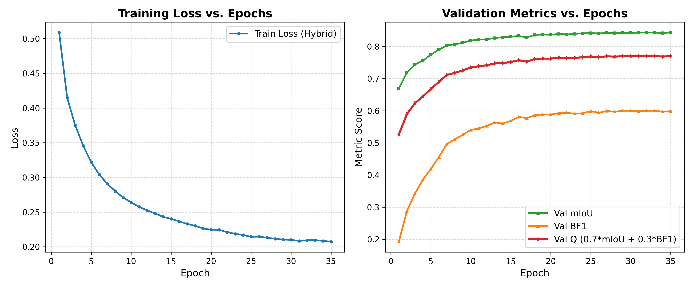
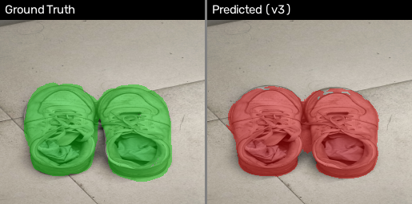
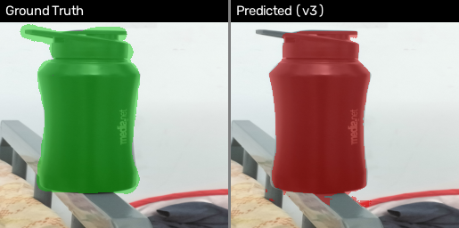
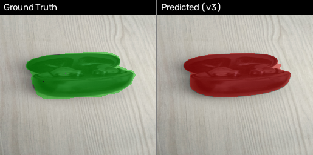
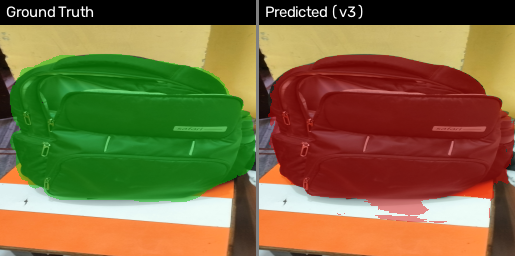
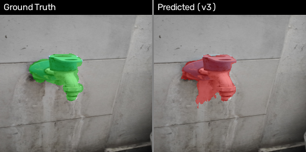
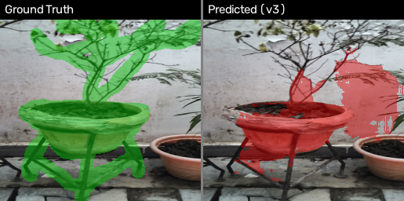

# CSL7360: Computer Vision — Assignment 2
# Track B: Cost-Efficient Segmentation under a Compute Budget

**Student**: Lokesh Motwani  
**Course**: CSL7360 — Computer Vision  

---

## 1. Introduction

This report describes the design, training, and evaluation of **FastSegUNet**, a cost-efficient foreground segmentation model developed for Track B of Assignment 2. The objective is to segment the main object from the background in any given image within a strict budget: average single-core CPU inference time $T_{\text{CPU}} \le 50\text{ ms}$ and model disk size $S_{\text{disk}} \le 4\text{ MiB}$.

The performance is measured using the **Cost-Efficient Segmentation (CES) score**:

$$\text{CES} = Q \times \left[1 - 0.20 \times \frac{T_{\text{CPU}}}{50\text{ ms}} - 0.10 \times \min\!\left(1,\ \frac{S_{\text{disk}}}{4\text{ MiB}}\right)\right]$$

where the quality score $Q$ combines mean Intersection-over-Union and Boundary F1:

$$Q = 0.70 \times \text{mIoU} + 0.30 \times \text{BF1}$$

---

## 2. Method

### 2.1 Architecture: FastSegUNet

FastSegUNet is a compact fully-convolutional U-Net–style encoder–decoder built entirely from **Depthwise Separable Convolutions** (`DSConvBlock`). Each `DSConvBlock` consists of a $3 \times 3$ depthwise convolution followed by a $1 \times 1$ pointwise convolution, each paired with Batch Normalization and ReLU. This factorisation reduces parameters by a factor of $k^2 / (1 + k^2/C_{\text{out}})$ relative to a standard convolution, enabling a very light model that is nonetheless expressive.

The architecture is configured with `base_ch = 16`, giving the following structure:

| Stage | Resolution | Channels | Operation |
|:---|:---:|:---:|:---|
| **Stem** | $256 \to 128$ | 16 | Stride-2 conv + DSConv |
| **enc2** | $128 \to 64$ | 16 → 32 | Stride-2 DSConv × 2 |
| **enc3** | $64 \to 32$ | 32 → 48 | Stride-2 DSConv × 2 |
| **enc4** | $32 \to 16$ | 48 → 64 | Stride-2 DSConv × 2 |
| **Bottleneck** | $16 \to 8$ | 64 → 96 → 64 | Stride-2 DSConv × 2 |
| **dec4** | $8 \to 16$ | 128 → 48 | Bilinear upsample + skip concat + DSConv |
| **dec3** | $16 \to 32$ | 96 → 32 | Bilinear upsample + skip concat + DSConv |
| **dec2** | $32 \to 64$ | 64 → 16 | Bilinear upsample + skip concat + DSConv |
| **dec1** | $64 \to 128$ | 32 → 16 | Bilinear upsample + skip concat + DSConv |
| **refine\_256** | $128 \to 256$ | 16 | Bilinear upsample + DSConv at full resolution |
| **Head** | 256 | 1 | $1 \times 1$ conv (binary logits) |

Skip connections concatenate encoder feature maps to the corresponding decoder stage, providing fine spatial detail to the decoder. The final refinement block operates at full $256 \times 256$ resolution before the binary segmentation head.

### 2.2 Loss Function

Training uses a **hybrid loss** combining pixel-weighted Binary Cross-Entropy (BCE) and Soft Dice:

$$\mathcal{L} = \mathcal{L}_{\text{BCE}}^{\text{edge-boosted}} + \mathcal{L}_{\text{Dice}}$$

The BCE term applies an edge boost factor of $2.0$ to pixels near ground-truth boundaries, encouraging the model to focus on boundaries during training — critical for BF1.

### 2.3 Inference Optimisations

All of the following optimisations are applied at inference time to maximise throughput within the single-core CPU budget:

1. **Normalisation folded into the model**: `x = x / 255.0` is computed inside `forward()`, not as a pre-processing Python operation. When `torch.jit.freeze` is applied, this constant scalar multiplication is fused directly into the stem's first convolution weights, eliminating the operation at runtime.

2. **TorchScript tracing and freezing**: The model is compiled with `torch.jit.trace` followed by `torch.jit.freeze`. This fuses `Conv → BatchNorm → ReLU` chains into single operators and removes per-op dispatch overhead.

3. **Two warm-up inference passes** are performed before timing begins — once for library warm-up and once to allow JIT freeze's additional graph optimisations to take effect.

4. **Strict single-threaded execution** is enforced by setting `OMP_NUM_THREADS`, `MKL_NUM_THREADS`, `OPENBLAS_NUM_THREADS`, and `VECLIB_MAXIMUM_THREADS` all to `1`, plus `cv2.setNumThreads(1)` and `torch.set_num_threads(1)` — all set before any of `numpy`, `opencv`, or `torch` are imported.

5. **FP16 model checkpoint**: Parameters are stored on disk as FP16 half-precision floats (`torch.save` of the FP16 state dictionary) and cast to FP32 only after loading. This halves disk footprint without any precision loss at inference (the model runs in FP32).

---

## 3. Training Setup

- **Dataset**: DUTS (Salient Object Detection dataset), using the DUTS-TR split for training.
- **Train / Validation split**: DUTS-TR (10,553 images) was split 90/10 using a fixed random seed (`seed=42`):
  - **Training**: 9,498 images
  - **Validation**: 1,055 images
- **DUTS-TE** (5,019 images): withheld entirely from training and checkpoint selection; used only for final evaluation.
- **Training platform**: Kaggle GPU (Notebook: `CES_TrackB_Kaggle_training_v3.ipynb`)
- **Hyperparameters**:
  - Epochs: 35
  - Optimiser: Adam
  - Learning Rate schedule: Cosine annealing
  - Batch size: 32
  - Checkpoint selection: Best validation $Q$ score
- **Preprocessing**: All images resized to $256 \times 256$ with `cv2.INTER_AREA`; all masks resized with `cv2.INTER_NEAREST` and thresholded at $\ge 128$ to produce binary {0, 1} maps.
- **Checkpoint export**: Saved as FP16 state dictionary (`weights_v3.pt`).

---

## 4. Quantitative Results

### 4.1 Benchmark Results

Hardware: **AMD Ryzen 5 7520U with Radeon Graphics** (single core, single thread enforced).

| Dataset / Split | Images | mIoU | Boundary F1 (BF1) | Quality ($Q$) | $T_{\text{CPU}}$ | $S_{\text{disk}}$ | **CES** |
|:---|:---:|:---:|:---:|:---:|:---:|:---:|:---:|
| Validation (DUTS-TR 10%) | 1,055 | 0.8433 | 0.5995 | 0.7702 | 27.01 ms | 144.8 KiB | 0.6842 |
| **DUTS-TE (Official Test)** | 5,019 | 0.6883 | 0.4298 | 0.6107 | **26.04 ms** | **144.8 KiB** | **0.5450** |
| Captured Photos (Own) | 6 | 0.8164 | 0.5198 | 0.7274 | 26.04 ms | 144.8 KiB | 0.6490 |

### 4.2 CES Score Decomposition (DUTS-TE)

$$Q = 0.70 \times 0.6883 + 0.30 \times 0.4298 = \mathbf{0.6107}$$

$$\text{Time penalty} = 0.20 \times \frac{26.04}{50.0} = 0.1042 \quad \text{(10.4\% of } Q \text{, with 48\% budget headroom)}$$

$$\text{Size penalty} = 0.10 \times \min\!\left(1,\ \frac{148{,}255}{4{,}194{,}304}\right) = 0.0035 \quad \text{(0.4\% of } Q\text{)}$$

$$\boxed{\text{CES} = 0.6107 \times (1 - 0.1042 - 0.0035) = \mathbf{0.5450}}$$

$S_{\text{disk}} = 148{,}255\text{ bytes}$ — only **3.5%** of the 4 MiB cap. The size penalty is negligible, placing almost all the remaining performance headroom in the time budget.

### 4.3 Training Progression

The model converges steadily over 35 epochs. Validation $Q$ rises from 0.526 at epoch 1 to 0.770 at epoch 35, with no sign of overfitting:

*Figure 1: Training loss (hybrid BCE+Dice, left) and validation metrics (mIoU, BF1, Q, right) over 35 epochs on DUTS-TR.*

---

## 5. Qualitative Results: Captured Photos

Six photos were captured on a mobile phone under real-world conditions, manually annotated, resized to $256 \times 256$, and evaluated against ground-truth masks.

| Photo | Subject | mIoU | BF1 | $Q$ |
|:---|:---|:---:|:---:|:---:|
| photo1 | Pair of shoes (indoor) | 0.9313 | 0.5487 | 0.8165 |
| photo2 | Shaker bottle on bed rail | 0.9235 | 0.5129 | 0.8003 |
| photo5 | Earbuds case on table | 0.9479 | 0.6723 | 0.8652 |
| photo6 | Backpack on desk | 0.9280 | 0.6000 | 0.8296 |
| photo7 | Water tap on tiled wall | 0.8553 | 0.6346 | 0.7891 |
| photo8 | Potted plant on stand | 0.4423 | 0.1500 | 0.3546 |

The overlays below show Ground Truth (green) alongside the v3 prediction (red).

### Photo 1 — Pair of Shoes (Q = 0.8165)

*Figure 2: photo1 — clean indoor subject with uniform background. High mIoU (0.931) shows accurate region segmentation; BF1 (0.549) reflects slight mask roughness around the lace gaps.*

### Photo 2 — Shaker Bottle (Q = 0.8003)

*Figure 3: photo2 — mostly correct region segmentation. BF1 (0.513) drops around the thin nozzle attachment at the top, where model prediction clips the boundary.*

### Photo 5 — Earbuds Case (Q = 0.8652)

*Figure 4: photo5 — best result overall. The compact, well-defined object on a plain wooden table yields the highest Q (0.865) and BF1 (0.672) of all six photos.*

### Photo 6 — Backpack (Q = 0.8296)

*Figure 5: photo6 — the large backpack is well-segmented (Object IoU 0.924). Minor over-prediction in the lower-right corner (table surface misidentified as foreground) slightly reduces BF1 (0.600).*

### Photo 7 — Water Tap (Q = 0.7891)

*Figure 6: photo7 — the tap body is mostly captured but the predicted mask leaks into the vertical mineral-water stain running down the wall below the tap. The stain shares chromatic and texture features with the shadowed underside of the white tap pipe, causing false positives (5,152 predicted vs. 4,318 GT pixels).*

### Photo 8 — Potted Plant (Q = 0.3546, Failure Case)

*Figure 7: photo8 — severe under-segmentation. The predicted mask covers only ~59% of the ground-truth area (15,089 vs. 25,507 pixels). See §6.1 for analysis.*

---

## 6. Analysis and Discussion

### 6.1 Failure Cases

**Primary failure — photo8 (potted plant): mIoU = 0.442, BF1 = 0.150, Q = 0.354**

This is the most significant failure among the six captured photos, and it stems from two compounding causes:

1. **Thin, high-aspect-ratio structures destroyed by downsampling**: The plant's bare branches are 1–2 pixels wide after rescaling to $256 \times 256$. With five successive stride-2 spatial reductions (stem + enc2 + enc3 + enc4 + bottleneck), the effective receptive field at the bottleneck ($8 \times 8$) loses all representation of these linear structures — they simply do not survive the downsampling cascade.

2. **Low-contrast background clutter**: The mottled wall staining, ambient foliage at the edges, and the second smaller pot partially share texture and colour statistics with the main plant–pot object. This causes both missed foreground (the branches) and spurious background activations.

The result is severe under-segmentation: the model predicts about 60% of the true object area and completely misses the branches, driving BF1 to 0.15.

**Second failure — photo7 (water tap): BF1 = 0.635 but over-prediction of 19%**

Despite an acceptable overall Q (0.789) and a higher BF1 than photo8, photo7 illustrates a different failure mode: boundary leakage due to low contrast between the object and a confounding background feature. The vertical water/mineral stain running down the tiled wall immediately below the tap is visually similar to the shadowed underside of the white tap pipe. The model's boundary grows downward into the stain region, adding approximately 834 false-positive pixels to the segmentation boundary.

### 6.2 Experiment: v2 → v3 Architecture Comparison

The v3 submission was a deliberate architectural experiment aimed at improving Boundary F1. The results were instructive but not in the direction intended.

**Hypothesis**: v2's BF1 (0.4559) was limited by refining at $128 \times 128$. Moving the single refinement DSConv block back to full $256 \times 256$ resolution — paid for by reducing `base_ch` from 24 to 16 — should recover boundary accuracy while remaining within the 50 ms budget.

**Results**:

| Metric | v2 | v3 | Change |
|:---|:---:|:---:|:---:|
| DUTS-TE mIoU | 0.6980 | 0.6883 | −0.0097 |
| DUTS-TE BF1 | 0.4559 | 0.4298 | **−0.0261** (worse) |
| DUTS-TE Q | 0.6253 | 0.6107 | −0.0146 (worse) |
| $T_{\text{CPU}}$ (ms) | 42.504 | **26.042** | −38.7% (faster) |
| $S_{\text{disk}}$ (bytes) | 249,631 | **148,255** | −40.6% (smaller) |
| **CES** | 0.5153 | **0.5450** | **+0.0297** (better) |

**What actually happened**: Both mIoU and BF1 decreased in v3. The full-resolution refinement did not compensate for the capacity reduction from narrowing channels 24 → 16. This is consistent with the known scaling behaviour of `DSConvBlock`: the pointwise $1 \times 1$ convolutions scale approximately as $C_{\text{in}} \times C_{\text{out}}$, so a one-third channel width reduction causes a roughly one-ninth reduction in parameter count per pointwise layer — a far steeper capacity drop than a simple ratio suggests. The model is therefore learning less expressive representations overall, which hurts boundary quality despite the higher-resolution refinement.

**CES still improved** — but for a different reason than intended. The drastic reduction in $T_{\text{CPU}}$ (from 42.5 ms to 26.0 ms) and $S_{\text{disk}}$ (from 249 KB to 148 KB) cut the time and size penalty terms in the CES formula by more than Q fell. The time penalty alone dropped from 17.0% to 10.4% of Q.

**Finding**: For this depthwise-separable architecture, **model capacity (channel width) matters more for boundary segmentation quality than refinement-stage resolution**. Recovering boundary accuracy would require either restoring `base_ch` to ≥ 24 (at the cost of speed), adding a dedicated boundary supervision branch, or using a larger training dataset.

A partial counterpoint: on the 6 captured photos, BF1 did marginally improve (0.498 → 0.520), suggesting the full-resolution refinement may benefit cleaner, close-range real photos more than DUTS-TE's broader and harder distribution. However, $n = 6$ is insufficient to draw strong conclusions.

### 6.3 Generalisation Gap

Validation Q (0.7702) is markedly higher than DUTS-TE Q (0.6107). Two factors likely contribute:

1. **Distribution shift**: The validation split is drawn from DUTS-TR, which was collected and annotated under the same conditions as the training images. DUTS-TE images are independently collected, likely harder on average and with somewhat different salient object statistics.

2. **Reduced capacity at `base_ch = 16`**: The narrower model may generalise less well on harder examples that require fine-grained boundary discrimination — consistent with the BF1 gap between validation (0.5995) and DUTS-TE (0.4298).

---

## 7. Conclusion

FastSegUNet achieves a CES score of **0.5450** on the DUTS-TE benchmark, with an average single-core CPU inference time of **26.04 ms** (48% below the 50 ms budget) and a model checkpoint of only **148,255 bytes** (3.5% of the 4 MiB cap). The model performs well on controlled captured photos ($Q$ 0.727 across 6 images) but shows a performance gap on the broader DUTS-TE distribution that is characteristic of the model's limited capacity.

The v2 → v3 experiment, while not achieving its intended improvement in boundary quality, produced a clearer finding: for depthwise-separable U-Net architectures at this scale, **increasing channel width is a more efficient lever for boundary segmentation quality than increasing the spatial resolution of the refinement stage**. The large speed and size gains from the channel reduction were the actual drivers of the improved CES score.

---

## 8. Deliverables

| File | Description |
|:---|:---|
| `predict.py` | Official submission inference script (`python predict.py --image ... --out ...`) |
| `weights.pt` | Final model checkpoint (FP16, 148,255 bytes) |
| `CES_TrackB_Kaggle_training_v3.ipynb` | Reproducible Kaggle training notebook |
| `model.py`, `dataset.py`, `metrics.py` | Core model, data loader, and evaluation metrics |
| `evaluate_v3_submission.py` | Full benchmark evaluation (validation + DUTS-TE + captured) |
| `time_official.py` | Official CPU timing benchmark script |
| `compute_ces.py` | CES score computation utility |
| `train_log_2.csv` | Per-epoch training and validation metrics (35 epochs) |
| `training_curves_v3.png` | Training curves figure |
| `submission_metrics_v3.json` | Machine-readable complete benchmark results |
| `captured/` | Original photos, 256×256 resized images and masks, overlays |
| `REPORT.md` | Complete assignment report with figures and analysis |
